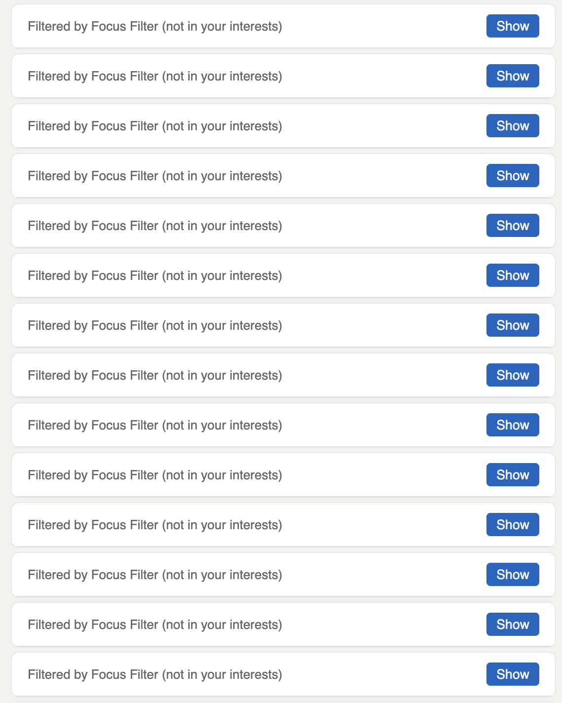

# LinkedIn Focus Filter

A Chrome extension (MV3) that filters the LinkedIn feed against your stated interests
using an on-device decision model. The model ships inside the extension, so it
makes no network calls at runtime, and post text does not leave the browser.



This is a personal project. It is not affiliated with or endorsed by LinkedIn.
It changes how the feed renders in your own browser. It does not use the
LinkedIn API and it does not send data anywhere. LinkedIn can change its markup
at any time, which can break the post selectors in `src/content.js`.

## How it works

- `src/content.js`: runs on the feed. Conceals each post on sight, then reveals
  it only if the model says it matches your interests.
- `src/dom-ops.js`: the DOM surgery (conceal, collapse, reveal, block the feed).
  Kept free of extension and model concerns so it can be tested.
- `src/junk-filter.js`: high-precision patterns for hiring ads, award posts and
  engagement bait. Matching hides the post with no model call at all.
- `src/decision.js`: the questions asked per post, answered in one forward
  pass: a choice over your topics plus "something else", your avoid topics, and
  what kind of post it is. A topic match only counts when the post is an
  explanation or a release, so a story that name-drops a tool stays hidden.
  Post text is NFKC-normalised first, because styled Unicode letters
  (𝗦𝗼𝗻𝗻𝗲𝘁) tokenize as garbage.
- `src/offscreen.js`: hosts the model in an offscreen document.
- `src/popup.*`: mode switch (off / filter / block feed), your topics, the
  model questions, status and counts.
- `src/log.*`: activity log with the full trace per post and summary graphs.

Model: Kev 0.6B (`onnx-community/kev-0.6b-ONNX`, q4f16, ~330 MB), a decision
model run with open-jev and Transformers.js on WebGPU. One forward pass returns
a probability per option; nothing is generated.

## Setup

Needs Node 18 or later and a Chromium browser with WebGPU.

```sh
npm install
node fetch-model.js     # Kev (~330 MB)
npm run build           # bundles into dist/
```

Load it in any Chromium browser (Chrome, Dia, Edge):

1. Open `chrome://extensions` and turn on Developer mode.
2. Click "Load unpacked" and select the `dist/` folder.
3. Open the extension popup, set the mode to "Filter", type your topics, and click Save.

The model needs WebGPU. Check `chrome://gpu` if the popup shows a model error.
After `npm run build`, click the reload icon on the extension card.

The model runs in an offscreen document (`src/offscreen.js`). Chrome applies
linkedin.com's CSP to WebAssembly in content scripts, and a service worker
forbids the dynamic `import()` that ONNX Runtime needs. The service worker only
creates the document. The content script then messages it directly, and one
document serves every LinkedIn tab.

## Tuning the model questions

The model generates no text, so there is no free-form system prompt. It answers
fixed questions by picking one option from each list. The popup's
**Model questions** section lets you change them:

- **Topic question**: the wording of the question that picks one of your
  topics or "something else".
- **"Something else" covers**: the description of the escape option. Posts
  the model puts there are hidden.
- **Post kinds that can be shown**: a post must match a topic and be one of
  the ticked kinds. Tick all seven to turn this check off.

Blank fields and the default ticks follow the shipped defaults in
`DEFAULT_OPTIONS` (`src/decision.js`). The activity log shows the questions
that each post got. Measure a change with `npm run eval` before you keep it,
because small wording changes moved the results in both directions.

## Icon

The icon is `shredder-filled` from
[Lucide Extended](https://github.com/applifted/lucide-extended) by Applifted,
ISC license. `src/icons/icon.svg` is the source, recoloured; the PNGs are
rendered from it.

## Tests

```sh
npm test
```

Runs the suite headlessly under jsdom and exits non-zero on failure. Covers the
DOM surgery, mode-switch teardown (the transitions that used to leave the feed
permanently hidden), the junk filter's safety property, and verdict parsing.

jsdom has no layout engine, so the one assertion about concealing preserving a
post's layout box is skipped there. For that, serve `test/` and open
`checks.html` in a browser:

```sh
cd test && python3 -m http.server 8790   # then open http://localhost:8790/checks.html
```

## Benchmarks

Model behaviour is measured, not guessed. The eval runs the shipped pipeline
(junk rules first, then the model) over a labelled corpus in a real Chromium
with WebGPU, via agent-browser in its own session, not your everyday browser.

```sh
npm run eval              # kev and laya
npm run eval -- kev       # one backend (comma-separated list for several)
```

| Backend | Model | Size | How it decides |
|---|---|---|---|
| `kev` | Kev-0.6B q4f16 (open-jev), **shipped** | ~330 MB | Decision model (Qwen3-0.6B base): one forward pass, a probability per option. |
| `laya` | Laya typed-decisions fp16 (`src/laya.js`) | ~850 MB | Decision model (ModernBERT-large): one pass per question. |

Kev and Laya each run the same question variants from `src/decision.js`
(`src/eval.js` lists them), so a winning variant ships by changing
`DEFAULT_OPTIONS`. Kev and Laya download from Hugging Face on the first run.

Corpus: 20 built-in cases (`src/bench-corpus.js`) plus 50 real feed posts in
`test/corpus-extra.json` (16 YES, 34 NO, 3 of them politics or war). Cases are
grouped by the interests they were labelled against.

The posts in `test/corpus-extra.json` are public feed posts with personal data
removed. Names of private people became made-up names. Personal links became
`example.com`, and a few identifying details became general. Public figures,
companies and products are unchanged. A re-run on the redacted posts gave the
same Kev results as the original text.

`npm run bench:baselines` scores keyword matching against the built-in cases
in Node, with no model and no GPU.

Scoring separates the two error directions, because they don't hurt equally:
hiding a wanted post is worse than letting junk through, so `penalty` counts a
false-hide double. Rank variants by penalty, not raw accuracy.

### Current results

Measured 2026-10-19, after the redaction described above. Every Kev row
scored the same as on the unredacted posts; Laya lost 3 posts. The 50 real posts were labelled against "ai engineer,
software engineer, SDLC." with "politics, war" to avoid. The described-interest
rows use the same intent written as four `topic: description` lines (see
`DESCRIBED_INTERESTS` in `src/eval.js`). Every row includes the text
normalisation and the people-widget junk rule.

50 real feed posts:

| Variant | Correct | False-hide | False-pass | Penalty | ms/call |
|---|---|---|---|---|---|
| kev: same, gate splits "release" into research news and product marketing | 44/50 | 1 | 5 | 7 | 219 |
| **kev: described interests, state prefix, kind-of-post gate (shipped default)** | 43/50 | 1 | 6 | 8 | 212 |
| kev: same, "judge the body" prefix | 45/50 | 3 | 2 | 8 | 220 |
| kev: same, but gate options without descriptions | 42/50 | 1 | 7 | 9 | 164 |
| kev: described interests, state prefix, no gate | 38/50 | 1 | 11 | 13 | 137 |
| kev: described interests, no prefix, no gate (previous release) | 37/50 | 1 | 12 | 14 | 135 |
| kev: shipped default with role-word interests | 37/50 | 3 | 10 | 16 | 177 |
| laya: best variant | 22/50 | 0 | 28 | 28 | 243 |

For reference, the generative Llama-3.2-1B setup this replaced scored 24/50
(2 false-hides, 24 false-passes, penalty 28, 163 ms/call).

20 built-in cases: kev with the shipped default scores 20/20. The "judge the
body" prefix hides a built-in Big-O post, which is why it does not ship despite
the higher raw accuracy. The research/marketing split also scores 20/20 and is
one post ahead on the real set; that is inside the noise of 50 posts, so it is
a candidate, not the default yet. Laya tops out at 17/20.

What the numbers say:

- The kind-of-post gate is the biggest single gain (penalty 13 to 8). It
  catches the stories and the hiring posts that match a topic by vocabulary.
- NFKC normalisation fixed the two wanted posts written in Unicode bold
  (a Terminal-Bench result and a model pricing post); before it they counted as
  false-hides in every variant.
- Interests written as role words ("software engineer") still cost the most:
  the same model with the same gate drops from penalty 8 to 16.
- What is left: one wanted post Kev files under "something else" in every
  variant (a vector-database explainer), two Portuguese and one Turkish
  post Kev cannot read (the models are English-only), a thumbnail-tool ad it
  calls a product release, and two stories it calls technical. Question
  wording did not move these; a larger model (`kev-4b`, 2.3 GB) is the next
  lever.
- Measured and dropped: yes/no "this post has technical substance" statements
  (Kev agrees with almost every post), a four-level substance score (hides
  wanted posts), an "is English" statement (no change), keeping opinions in
  the gate (no change), a sharper "something else" description (no change),
  and confidence thresholds on YES (false-hides).

Promoted posts never reach the model: the header rule caught 40 of 42 ads in
the logs, and the 2 misses ("Promoted by <company>") are matched now. The
"Recommended for you" people widget, which renders as a post, is a junk rule too.

### Growing the eval set from real use

The corpus saturates quickly. Once several variants score perfectly it can't
tell them apart. Feed it real posts:

1. Browse LinkedIn with the filter on (or run the debug build with the
   telemetry collector, which logs every post).
2. Open the popup and click **Open activity log**.
3. Mark verdicts ✓ or ✗ (✗ records the opposite as the wanted answer).
4. Click **Export eval set** and merge the cases into `test/corpus-extra.json`.
5. Re-run `npm run eval`.

The export holds other people's post text from your feed. Remove names and
links before you commit it.
